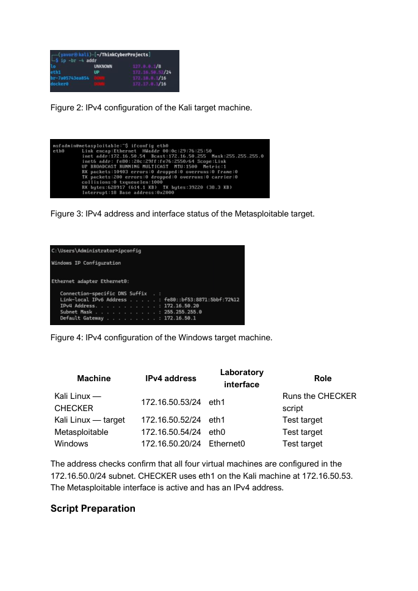

# CHECKER Security Lab

A menu-driven Bash laboratory tool for repeatable network security tests and session evidence.

Developed as ThinkCyber coursework by **Javor Mirchev**, with AI-assisted coding and report preparation. Laboratory setup, test execution and screenshots were carried out by the author.

## What it does

- Selects a local IPv4 laboratory interface and discovers hosts.
- Runs Nmap TCP scans, authorized SSH dictionary tests and controlled ARP demonstrations.
- Records session IDs, run outcomes, exit codes, elapsed time and the script checksum.
- Uses bounded execution and cleanup for interrupted runs.
- Separates a completed tool run from proof that a finding or network effect occurred.

## Requirements

Linux, Bash 4.2+, GNU coreutils, iproute2, procps, util-linux, Nmap, Hydra and dsniff/arpspoof.

The operational workflow was developed for a Linux laboratory. Windows/Git Bash is used only for the offline portfolio checks described below.

## Usage

Start with help, which performs no installation or network/deployment action:

```bash
bash scripts/checker.sh --help
```

Authorized laboratory workflow:

```bash
sudo bash scripts/checker.sh --ports 22,80,443
```

## Evidence and validation



This is a selected historical report excerpt from the author's own laboratory. Historical filenames remain visible. It is not a screenshot of the portfolio revision being re-tested.

- [Laboratory evidence and provenance](docs/EVIDENCE.md)
- [Current offline validation and its limits](docs/VALIDATION.md)
- [Authorship and AI assistance](docs/AUTHORSHIP.md)

Run the local automated checks without an assessment target:

```bash
bash -n scripts/checker.sh
shellcheck scripts/checker.sh
python3 -m unittest discover -s tests -v
```

The included GitHub Actions workflow runs these offline checks after publication. No remote CI result is claimed before it runs.

## Limitations and handling of output

- This is a laboratory test generator, not a SIEM, IDS or automatic incident-detection system.
- ARP demonstrations require a target and peer on the same authorized Ethernet segment.
- Private session logs may contain discovered credentials.
- Cleanup is an attempted recovery action; verify the final network state on the target.

## Portfolio revision

The original coursework script remains unchanged in the author's local source folder. This repository uses a readable script name and includes the following limited changes:

- Removed an unused parsing variable and clarified a validation branch.
- Port-list validation now rejects port zero consistently with the documented 1-65535 range.

The full original reports, raw assessment results, credential files and course assignment briefs are not distributed here. No open-source license is included, by the author's choice.
